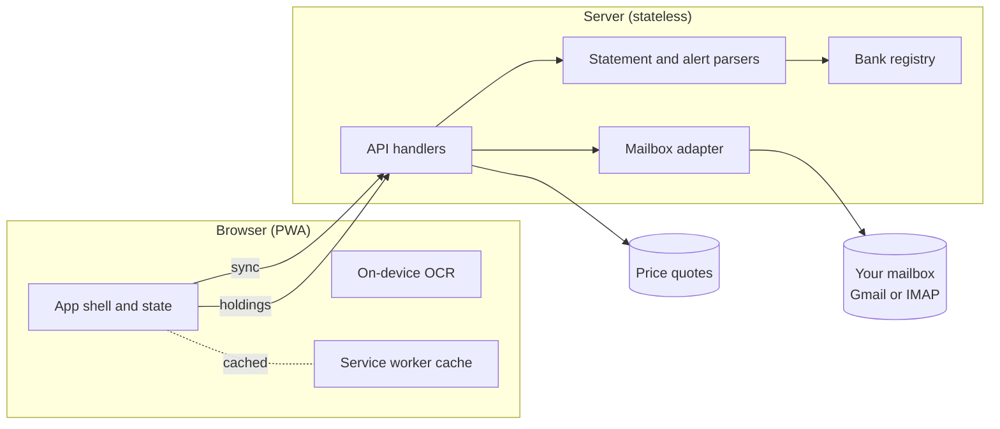

<p align="center">
  
</p>

<h1 align="center">Crumina</h1>

<p align="center">Your money, all in one place, without handing it to anyone.</p>

<p align="center">
  <a href="https://github.com/Marcel-Bonifacio/crumina-finance/releases/latest"></a>
</p>

<p align="center">
  <a href="LICENSE"></a>
  <a href="https://github.com/Marcel-Bonifacio/crumina-finance/releases"></a>
  
</p>

---

Crumina is a personal finance app you run yourself. It reads the bank statements and
transaction alerts already sitting in your mailbox and turns them into one view of
your accounts, spending and net worth. Nothing goes into a shared ledger, and the
web app has no analytics. (The Android app's ML Kit OCR does send
usage metrics to Google. The privacy page has the details.)

You can sign in with Google, connect any mailbox over IMAP, or skip accounts and keep
everything on one device. The web app installs as a PWA, works offline after the first
sync, and speaks English and Bahasa Indonesia.

The Android app is a signed APK. Tap the button above, or pick a version from
[Releases](https://github.com/Marcel-Bonifacio/crumina-finance/releases). Android will
ask you to allow installs from your browser the first time.

> Status: beta. A few bank layouts are parsed out of the box and everything else falls
> back to generic patterns. See [Supported statements](#supported-statements).

## Contents

- [Features](#features)
- [How it works](#how-it-works)
- [Quick start](#quick-start)
- [Configuration](#configuration)
- [Supported statements](#supported-statements)
- [Project structure](#project-structure)
- [Tech stack](#tech-stack)
- [Android app](#android-app)
- [Documentation](#documentation)
- [Security and privacy](#security-and-privacy)
- [Contributing](#contributing)
- [License](#license)
- [Third-party software](#third-party-software)

## Features

- Reads Gmail through OAuth, or any mailbox over IMAP. It only reads: Crumina never
  sends, deletes or changes mail.
- Extracts balances and transaction rows from monthly PDF e-statements, and unlocks
  password-protected PDFs with a per-bank password you enter.
- Turns bank and card notification emails into transactions as they arrive. Senders
  it doesn't know go through a heuristic parser.
- Avoids counting the same money twice: alerts are matched against the monthly
  statement, transfers between your own accounts are paired, and a card bill payment
  counts as settlement, not spending.
- Rolls savings, cards, securities cash and a manually tracked investment portfolio
  into one net worth, with live prices for holdings.
- Categorises transactions, shows where the money goes, and has an Insights view for
  any date range. There's also a rough carbon estimate of your spending.
- Receipt OCR runs in the browser with a bundled Tesseract build, so the photo never
  leaves your machine.
- Local mode needs no account and keeps everything in the browser.
- Opens without a connection (a service worker caches the app) and syncs again when
  you're back online.

## How it works

The browser holds the app and most of the state. The server is a thin layer that
reads your mailbox, decrypts statement PDFs and signs you in. It does not keep a copy
of your finances; parsed results are returned to the browser and not stored.



Most bank-specific settings live in [`app/lib/banks.js`](app/lib/banks.js): the email
senders for statements, statement password slots, balance patterns, and the
domain-to-name map for alerts. The alert sender domains that sync searches are listed
in `app/api/sync.js`, and the CIMB and Permata alert parsers are in `app/lib/parse.js`.
To add a bank, follow [docs/BANK-PARSERS.md](docs/BANK-PARSERS.md). The rest of the
design is in [docs/ARCHITECTURE.md](docs/ARCHITECTURE.md).

## Quick start

You need Node 20.19 or newer (22 LTS works well). There's no build step for the
client.

```bash
git clone https://github.com/Marcel-Bonifacio/crumina-finance.git
cd crumina-finance/app
npm ci --omit=dev          # installs the PDF and IMAP libraries

cd ../selfhost
cp .env.example .env        # set SESSION_SECRET and TOKEN_ENC_KEY at minimum
node server.js              # serves the whole app on http://localhost:3000
```

Open `http://localhost:3000` and choose **Use locally** to try it with no accounts,
or connect a mailbox. Generate the two secrets with:

```bash
openssl rand -base64 48     # SESSION_SECRET
openssl rand -base64 32     # TOKEN_ENC_KEY
```

To run it in a container instead, with automatic HTTPS through Caddy:

```bash
cd selfhost
cp .env.example .env
docker compose up -d --build
```

The full deployment guide, including systemd and any-platform notes, is in
[docs/SELF-HOSTING.md](docs/SELF-HOSTING.md).

## Configuration

Server configuration comes from environment variables. The two required values are
`SESSION_SECRET` (signs the session cookie) and `TOKEN_ENC_KEY` (a 32-byte base64 key
that encrypts stored secrets). Google sign-in and IMAP are optional and activate only
when their variables are set. The Android app's domain is set in code, not in the
environment: `APP_LINK` in `app/api/auth/callback.js`, `API_BASE` in
`android/app/build.gradle.kts`, and the App Link host in `AndroidManifest.xml` and
`network_security_config.xml`.

| Variable | Required | Purpose |
|---|---|---|
| `SESSION_SECRET` | yes | Signs the session cookie (HMAC-SHA256) |
| `TOKEN_ENC_KEY` | yes | AES-256-GCM key for tokens, credentials and statement passwords |
| `GOOGLE_CLIENT_ID` / `GOOGLE_CLIENT_SECRET` / `GOOGLE_REDIRECT_URI` | no | Enable Google sign-in |
| `IMAP_ENABLED` | no | Show the IMAP sign-in option (self-host) |
| `IMAP_ALLOW_PRIVATE` | no | Allow IMAP hosts on private or loopback addresses |
| `PORT` | no | Port for the self-host server (default 3000) |
| `TRUST_PROXY` | no | When to trust `X-Real-IP` for rate limiting (default: only from Vercel or a private-network proxy) |

Before running a public instance, change the domain and contact email in
`app/privacy.html` and `app/terms.html`, and point `REPO` in `app/app.js` at the
repository that holds your source. [docs/CONFIGURATION.md](docs/CONFIGURATION.md)
lists each location.

## Supported statements

Crumina knows a handful of statement and alert layouts from the bank registry. For
everything else it falls back to generic patterns like "closing balance" and "amount
due". Amounts parse in both `1,234,567.89` and `1.234.567` styles.

Adding a bank's statements is one entry in `app/lib/banks.js`: the sender address, a
password slot if the PDF is locked, and one or more balance patterns. The parsing
engine doesn't change. Real-time alerts from a new
sender also need its domain in `app/api/sync.js`. The format and a worked example are
in [docs/BANK-PARSERS.md](docs/BANK-PARSERS.md).

## Project structure

```
app/                 the deployable web app
  index.html app.js  client (vanilla JS, no framework, no build)
  api/               request handlers, one file per endpoint
  lib/               session, crypto, mailbox, parsing, rate limiting
  lib/banks.js       institution registry (senders, balance patterns, labels)
  vendor/tesseract/  on-device OCR assets
  brand/             logos and icons
selfhost/            server.js, Dockerfile, compose, Caddy, systemd unit
android/             native Android app (Kotlin, Jetpack Compose)
docs/                architecture, configuration, self-hosting, security, API, Android
brand/               logo and icon assets
```

## Tech stack

The client is vanilla HTML, CSS and JavaScript with no framework and no bundler. The
server is plain Node: serverless-style `(req, res)` handlers that also run behind a
small built-in HTTP server when you self-host. PDFs go through `pdfjs-dist`, IMAP
through `imapflow` and `mailparser`. State lives in the browser, and the server has no
transaction database.

## Android app

[Download the latest APK](https://github.com/Marcel-Bonifacio/crumina-finance/releases/latest) (`crumina-<version>.apk`)
(Android 8.0 or newer).

The Android app is Kotlin and Jetpack Compose, and it talks to the same backend as the
web app. It has the same features, including statement unlock, budgets, recurring
payments, goals and receipt OCR (ML Kit, on the device). Every `v*` tag makes CI build,
sign and publish a new APK. Auth flow, build and signing steps are in
[docs/ANDROID.md](docs/ANDROID.md).

## Documentation

| Document | What it covers |
|---|---|
| [Architecture](docs/ARCHITECTURE.md) | Components, data flow, request lifecycle |
| [Configuration](docs/CONFIGURATION.md) | Environment variables and options |
| [Self-hosting](docs/SELF-HOSTING.md) | Running your own instance, with or without Docker |
| [Bank parsers](docs/BANK-PARSERS.md) | Adding or changing a supported institution |
| [API reference](docs/API.md) | Endpoints and their contracts |
| [Android](docs/ANDROID.md) | Native app: architecture, auth, build and signing |
| [Security](docs/SECURITY.md) | Threat model, cryptography, disclosure |
| [Contributing](CONTRIBUTING.md) | Development setup and conventions |

## Security and privacy

Crumina only reads your mailbox. Google refresh tokens, IMAP credentials and statement passwords are encrypted at
rest with AES-256-GCM, and sessions are signed `HttpOnly` cookies. The server sends a
strict Content-Security-Policy and keeps no record of your transactions. The threat
model and how to report a vulnerability are in
[docs/SECURITY.md](docs/SECURITY.md).

## Contributing

Pull requests are welcome, especially new bank layouts. The project stays small with
few dependencies on purpose, so please read [CONTRIBUTING.md](CONTRIBUTING.md) first.

## License

Apache License 2.0 ([LICENSE](LICENSE)). You can use, change and redistribute
Crumina, including as a hosted service. Keep the license and copyright notices, and
mark the files you changed.

## Third-party software

The on-device OCR in `app/vendor/tesseract/` is tesseract.js 5.1.1 with
tesseract.js-core and the English and Indonesian trained data, all under the Apache
License 2.0. They, and the npm and Android dependencies, keep their own licenses. See
[THIRD_PARTY_NOTICES.md](THIRD_PARTY_NOTICES.md).
