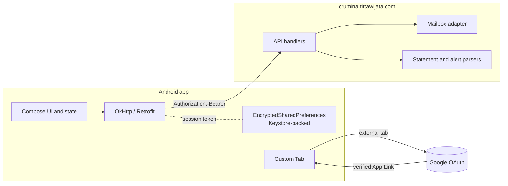
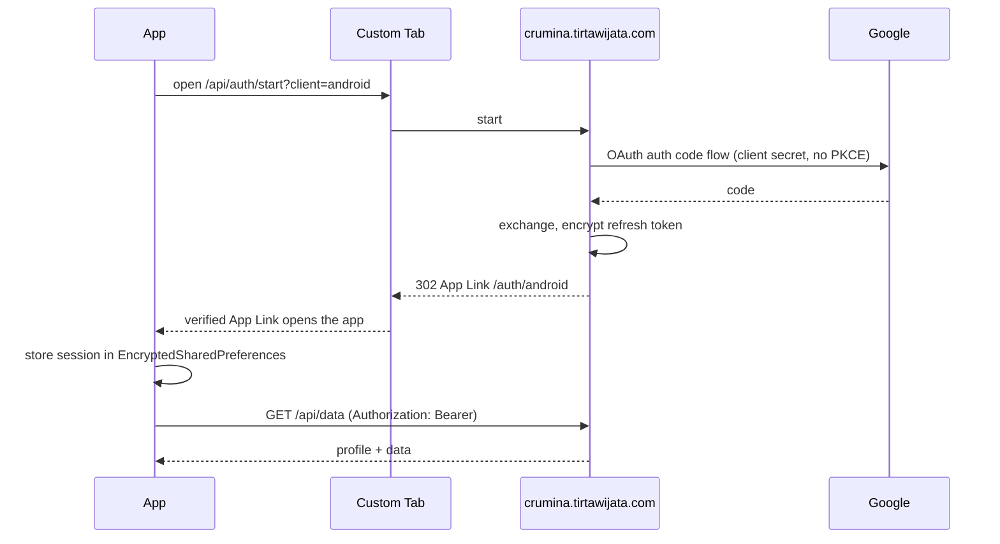

# Crumina on Android

This document covers how Crumina ships as a native Android app: the architecture, the
sign-in flow, the security controls, the server-side support for the app, and how the
signed APK is built in CI.

## Why native

The Android client is a native Kotlin / Jetpack Compose app, not a Trusted Web
Activity or a WebView wrapper. A native app gives platform-native UX and
Keystore-backed credential storage. The trade-off is that the PWA's UI is written a
second time in Compose, so the two clients share no UI code. The app uses the same
JSON API as the web client, so parsing, sync, FX and quote logic stay on the server.

The app talks to one origin only, `https://crumina.tirtawijata.com`, over TLS. The only
third party it touches is Google sign-in, and that happens in an external browser tab,
never inside the app.

## Architecture at a glance



The phone holds the UI, app state and the user's session token. The server still does
the privileged work (reads the mailbox, decrypts statements, signs the user in) and
keeps no copy of the user's finances.

## Authentication

The web app signs in with Google OAuth and the server sets `HttpOnly` cookies. A native
app cannot use those cookies, and Google's policy forbids running OAuth inside an
embedded WebView. So the app signs in with three pieces: an external user-agent, a
verified App Link, and a server that hands the app a bearer token.

### Flow

1. The app opens a **Chrome Custom Tab** to `GET /api/auth/start?client=android`.
   (Custom Tabs are the Google-sanctioned external user-agent; they share the system
   browser's session and are not controllable by the app.)
2. The server runs the same Google OAuth exchange as for the web client. It gets the
   user's profile and, when Google returns one, a refresh token, which it encrypts.
3. Instead of setting cookies, the server returns a **302 to a verified App Link**:
   `https://crumina.tirtawijata.com/auth/android#t=<session>&p=<profile>&rt=<enc_refresh>`
   The payload rides in the URL fragment (after `#`), which the browser does not send
   to any server. The tokens are still in that URL, though, so whatever ends up
   handling it receives them. If the browser shows the fallback page, its script
   (`app/auth/android.js`) strips the fragment from the address bar and history entry.
4. Android opens the app directly because the app declares an intent filter for that
   HTTPS path and the path is verified by Digital Asset Links (`assetlinks.json`, keyed
   to the app's signing certificate). This only holds while
   `/.well-known/assetlinks.json` is publicly reachable and lists the certificate the
   installed APK is signed with, so the redirect is not hijack-proof. If verification fails, Android 12 and later open the
   link in the browser instead, which shows `app/auth/android.html`. Older versions can
   show a chooser, and another app that declares the same URL could then receive the
   fragment.
5. The app reads the fragment, stores the session in **EncryptedSharedPreferences**, and
   from then on sends `Authorization: Bearer <session>` on every API call.



### Where the Gmail refresh token lives

The server has no database, so it cannot keep the Gmail refresh token keyed to a
session. The app stores the *encrypted* refresh token (Keystore-backed at rest) and
sends it on sync in an `X-Cr-Rt` header. The server decrypts it with `TOKEN_ENC_KEY`
and uses it the same way as the `tally_rt` cookie. The token is never stored in
plaintext or logged. If the deployment gains a KV store, refresh tokens could move
server-side so the app holds only the session bearer.

Statement passwords sit in the same encrypted store on the phone. The app sends them
to `/api/statements` in an `X-Cr-Pw` header (base64-encoded JSON over TLS); the server
uses them for that request and does not keep them.

The Android app supports Google sign-in only. Local mode and IMAP sign-in are
available in the web client only.

## Security controls

| Area | Control |
|---|---|
| OAuth | External user-agent (Chrome Custom Tabs), never an embedded WebView, as required by Google's secure-browser policy |
| Redirect integrity | App Link with `android:autoVerify="true"`, verified against `/.well-known/assetlinks.json`. Only as strong as that verification (see step 4 of the flow) |
| Token storage | AndroidX Security `EncryptedSharedPreferences` with an AES256_GCM `MasterKey` in the Android Keystore. StrongBox is not requested |
| Backups | `android:allowBackup="false"`, `android:fullBackupContent="false"`, and `dataExtractionRules` that exclude both encrypted stores from cloud backup and device transfer |
| Screen privacy | `FLAG_SECURE` on the whole window (set in `MainActivity`), blocking screenshots and the recents thumbnail |
| Transport | `network_security_config.xml`: `cleartextTrafficPermitted="false"`. A certificate pin-set is included but commented out, so a certificate rotation cannot lock out installed apps |
| Permissions | `INTERNET` only. Receipt OCR runs ML Kit on an image picked through the system picker, so the app needs no `CAMERA` permission |
| Release hardening | R8 minify and resource shrinking (`isMinifyEnabled`, `isShrinkResources`). The app source makes no `android.util.Log` calls |
| App signing | Self-managed release key. CI signs the APK with the keystore held in repository secrets (see [Build and signing](#build-and-signing-github-actions)), so anyone who can read those secrets can sign an update |
| Dependencies | Pinned versions (AndroidX Browser, AndroidX Security, Retrofit/OkHttp, ML Kit text recognition) |

Not implemented: PKCE on the Google OAuth request (the server is a confidential
client and authenticates with the client secret), Play Integrity attestation, a
biometric app lock, a StrongBox-backed master key, certificate pinning, and Play App
Signing (the app is distributed through GitHub Releases, not Google Play).

## Server support for the native client

All of this lives in existing handlers, so the deployment stays under the 12-function
limit of the Vercel Hobby plan.

- `app/lib/session.js`: `fromReq` reads the `tally_session` cookie or, if there is
  none, an `Authorization: Bearer` header, so the app authenticates with the same
  signed session as the web client.
- `app/lib/mailbox.js` (`getMailbox`): reads the encrypted refresh token from the
  `tally_rt` cookie, or from the `X-Cr-Rt` header when there is no cookie.
- `app/api/statements.js`: reads statement passwords from the `tally_pw` cookie, or
  from the `X-Cr-Pw` header when the cookie holds none.
- `app/api/auth/start.js`: `?client=android` appends `.android` to the OAuth `state`.
  The `oauth_state` nonce cookie still provides CSRF protection.
- `app/api/auth/callback.js`: when the state ends in `.android`, the handler clears
  `oauth_state`, sets no session cookies, and redirects (302) to `APP_LINK`
  (`https://crumina.tirtawijata.com/auth/android`) with `t`, `p` and, when Google
  returned a refresh token, `rt` in the fragment.
- `app/.well-known/assetlinks.json`: served at `/.well-known/assetlinks.json` with the
  package name and the release signing SHA-256 (see
  [Deploying](#deploying-cruminatirtawijatacom) below).
- `app/auth/android.html` and `app/auth/android.js`: the page the browser shows if the
  App Link does not open the app, and the script that strips the fragment.
- `app/middleware.js` (Vercel) and `isPublic` in `selfhost/server.js` (self-host): make
  `/.well-known/assetlinks.json` and `/auth/android` public, so Android can fetch the
  Asset Links file without a session and the fallback page loads.

## Project structure

```
android/
  settings.gradle.kts
  build.gradle.kts                  root build config + plugin versions
  gradle.properties
  gradle/wrapper/                   gradle-wrapper.properties (pins Gradle 8.7)
  app/
    build.gradle.kts                deps, API_BASE, signing config (reads CI env)
    proguard-rules.pro
    src/main/AndroidManifest.xml    INTERNET permission, App Link intent filter
    src/main/res/xml/
      network_security_config.xml   no cleartext; pin-set present but commented out
      data_extraction_rules.xml     keeps the encrypted stores out of backups
    src/main/java/id/tirtawijata/crumina/
      CruminaApp.kt
      MainActivity.kt               FLAG_SECURE, sign-in screen, App Link handling
      auth/AuthManager.kt           Custom Tab launch + App Link callback
      data/Api.kt                   Retrofit interface for crumina.tirtawijata.com
      data/Net.kt                   OkHttp with Bearer interceptor
      data/SecureStore.kt           encrypted store: session, refresh token, statement passwords
      data/Store.kt                 encrypted local cache: accounts, holdings, settings
      data/Repo.kt                  app state, sync and on-device persistence
      data/Models.kt                API responses and local data classes
      data/Categorize.kt            merchant to category rules, ported from the web app
      data/Ocr.kt                   ML Kit receipt OCR
      data/Strings.kt               English and Bahasa Indonesia strings
      ui/AppScaffold.kt             bottom navigation for the five tabs
      ui/OverviewScreen.kt          net worth, cash, investments
      ui/Dashboard.kt               insights, trend, budgets, recurring, carbon, goals
      ui/AccountsScreen.kt
      ui/ActivityScreen.kt
      ui/PortfolioScreen.kt
      ui/SettingsScreen.kt
      ui/Components.kt              shared composables
      ui/Theme.kt
```

## Screens

Five tabs:

- Overview: net worth, cash and investments, insights, a 6-month spending trend,
  budgets, recurring payments, a carbon estimate and savings goals.
- Accounts: accounts from statements and manual entries, and PDF statement upload.
- Activity: transactions, and manual expenses with on-device receipt OCR.
- Portfolio: holdings with live quotes.
- Settings: currency, language, hide amounts, statement unlock, sync and log out.

App data is cached in `EncryptedSharedPreferences` (`data/Store.kt`), and the UI is in
English and Bahasa Indonesia (`data/Strings.kt`).

## Build and signing (GitHub Actions)

CI is the build path. The workflow (`.github/workflows/android.yml`) sets up JDK 17,
the Android SDK and Gradle 8.7, runs `gradle assembleDebug` to check that the app
compiles, then `gradle assembleRelease`. The release APK is signed when the keystore
secrets are set (pull requests always get an unsigned build), and the APKs are
uploaded as a run artifact. The workflow runs on pushes to the `android` branch, on
pull requests into `android` or `main`, and on manual dispatch. Pushing a version tag
(`vX.Y.Z`) also runs a separate release job that publishes the signed APK as a
pre-release on GitHub Releases.

Required repository secrets:

| Secret | What it is |
|---|---|
| `ANDROID_KEYSTORE_BASE64` | your release keystore, base64-encoded |
| `ANDROID_KEYSTORE_PASSWORD` | keystore password |
| `ANDROID_KEY_ALIAS` | key alias |
| `ANDROID_KEY_PASSWORD` | key password |

Generate the keystore once, on your own machine, and keep it safe (losing it means you
cannot update the app):

```bash
keytool -genkeypair -v -keystore crumina-release.jks \
  -alias crumina -keyalg RSA -keysize 4096 -validity 10000
base64 -w0 crumina-release.jks   # paste into the ANDROID_KEYSTORE_BASE64 secret
```

Get the SHA-256 fingerprint for `assetlinks.json`:

```bash
keytool -list -v -keystore crumina-release.jks -alias crumina | grep SHA256
```

CI decodes the keystore from the secret into a temporary file at build time and deletes
it afterward; the keystore is never committed.

## Distribution

- **Sideload APK.** Download the signed APK from the
  [Releases](https://github.com/Marcel-Bonifacio/crumina-finance/releases) page (or take
  `app-release.apk` from a CI run) and install it. The device must allow installing
  from unknown sources.
- **Google Play.** Not set up. Publishing there would mean switching the release step
  to `bundleRelease` (an `.aab`), enrolling in Play App Signing, adding Play's
  app-signing SHA-256 to `assetlinks.json`, and uploading to the Play Console. Play
  Integrity attestation only becomes an option for Play-installed builds. Play also
  requires a privacy policy (already at `/privacy`) and a data-safety declaration:
  read-only mailbox access, finances stored on device/your server, no third-party
  analytics.

## Deploying crumina.tirtawijata.com

The native app points at `https://crumina.tirtawijata.com`, so that origin must serve the
existing `app/` (same code as the web deploy) with these set:

- **Env vars:** `SESSION_SECRET`, `TOKEN_ENC_KEY`, `GOOGLE_CLIENT_ID`, `GOOGLE_CLIENT_SECRET`,
  and `GOOGLE_REDIRECT_URI=https://crumina.tirtawijata.com/api/auth/callback`.
- **Google console:** add `https://crumina.tirtawijata.com/api/auth/callback` to the
  OAuth client's authorized redirect URIs.
- **Asset Links:** `app/.well-known/assetlinks.json` is served at
  `/.well-known/assetlinks.json` and already holds the release signing SHA-256. If you
  change the signing key, update it (`keytool -list -v -keystore crumina-release.jks
  -alias crumina | grep SHA256`). If it does not match the installed APK's certificate,
  App Link verification fails and sign-in falls back to the browser page at
  `app/auth/android.html`.
- **Verify:** both `/.well-known/assetlinks.json` and `/auth/android` are public on
  Vercel and on self-host. After deploy, check the file without a session:

  ```bash
  curl -sI https://crumina.tirtawijata.com/.well-known/assetlinks.json
  # expect HTTP 200 and content-type: application/json, not a 302 to /login
  ```

  Android verifies the link on install. To re-run verification on a device with the
  app installed (Android 12 and later) and read the result:

  ```bash
  adb shell pm verify-app-links --re-verify id.tirtawijata.crumina
  adb shell pm get-app-links id.tirtawijata.crumina   # crumina.tirtawijata.com: verified
  ```
